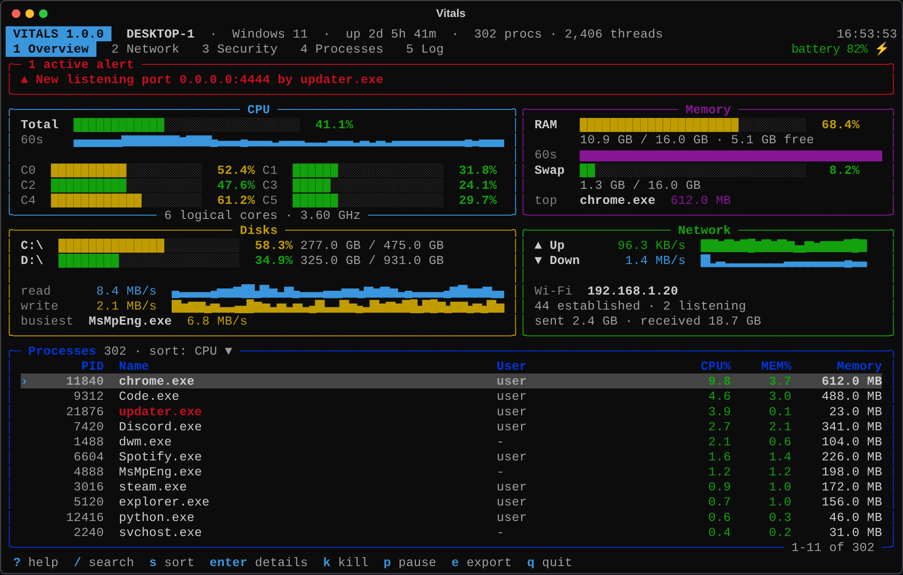
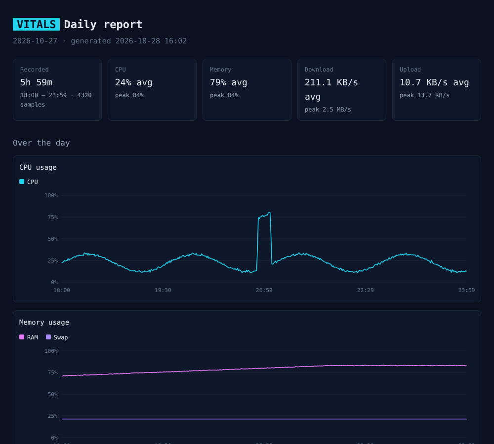

# Vitals

[English](README.md) | **Türkçe**

Görev Yöneticisi'nin bir adım ötesine geçen bir terminal sistem monitörü. Vitals; işlemci, bellek, disk ve ağı canlı geçmiş grafikleriyle gösterir, tüm ağ bağlantılarını ve açık portları listeler, şüpheli süreçleri işaretler, uyarı verir, her şeyi diske kaydeder ve bir günün verisini HTML rapora dönüştürür.



## Özellikler

### İzleme
- **CPU:** toplam ve çekirdek başına kullanım, frekans, sıcaklık (Linux) ve 60 saniyelik geçmiş grafiği
- **Bellek:** RAM ve swap kullanımı, boş bellek, en çok RAM kullanan süreç
- **Diskler:** tüm sürücülerin doluluğu, anlık okuma/yazma hızı ve diski en çok kullanan süreç
- **Ağ:** geçmişiyle birlikte anlık yükleme/indirme hızı, aktif ağ bağdaştırıcısı ve IP adresi
- **Sistem:** çalışma süresi, süreç ve thread sayısı, pil durumu

### Ağ ve güvenlik
- **Bağlantılar:** her TCP/UDP bağlantısı; hangi süreç, hangi uzak adres ve hangi durumda. Genel IP'lerin alan adları arka planda bulunur
- **Açık portlar:** dışarıdan bağlantı bekleyen her program, risk etiketiyle:
  `suspicious` (şüpheli süreç ya da arka kapı portu), `exposed` (ağa açık veritabanı veya uzak erişim), `open` (ağdan erişilebilir), `system` ve `local` (sadece bu bilgisayar)
- **Şüpheli süreç tespiti:** şu programları işaretler:
  - Temp ya da İndirilenler klasöründen çalışanlar
  - Windows klasörü dışında bir sistem adı (ör. `svchost.exe`) kullananlar
  - Yeni başlayıp tüm ağ arayüzlerini dinleyenler
  - Arka kapılarda sık kullanılan portları (4444, 1337, 31337…) dinleyenler

### Uyarılar ve kayıt
- CPU veya RAM belirli bir sınırın üstünde kaldığında, disk dolduğunda, yeni bir port açıldığında ya da şüpheli bir süreç çıktığında uyarı şeridi
- İsteğe bağlı terminal zil sesi
- Uyarılar, güvenlik olayları ve açılıp kapanan süreçler için olay günlüğü
- Ölçümler günlük CSV dosyasına, olaylar günlük log dosyasına kaydedilir
- O anki durumu JSON olarak dışa aktarma
- Kaydedilmiş herhangi bir gün için grafikli, zirve anlarını ve uyarıları gösteren **HTML rapor**

### Etkileşim
- Beş sekme: Overview, Network, Security, Processes, Log
- Klavyeyle arama, sıralama ve seçim
- Süreç detayı: dosya yolu, komut satırı, üst süreç, açık dosyalar, bağlantılar ve neden işaretlendiği
- Süreci sonlandırma (onaylı), klasörünü açma, yolunu kopyalama
- Program dosyasının SHA-256 özeti ve tek tuşla VirusTotal sorgusu



## Kurulum

Python 3.11 veya üzeri gerekir.

```bash
git clone https://github.com/Enes0102/vitals-monitor.git
cd vitals-monitor
pip install -r requirements.txt
```

## Kullanım

```bash
python -m vitals
```

| Seçenek | Açıklama |
|---|---|
| `-i`, `--interval SANİYE` | Yenileme aralığı (varsayılan: 1.0) |
| `-c`, `--config YOL` | Belirli bir ayar dosyası kullanır |
| `--no-log` | Diske hiçbir şey yazmaz |
| `--report [TARİH]` | Bir gün için HTML rapor oluşturur (`YYYY-AA-GG`, varsayılan: bugün) |
| `--no-open` | `--report` ile birlikte, tarayıcıyı açmaz |
| `--version` | Sürümü gösterir |

Örnekler:

```bash
python -m vitals -i 2
python -m vitals --report
python -m vitals --report 2026-10-27
```

### Sekmeler

| Sekme | Ne gösterir |
|---|---|
| **1 Overview** | CPU (toplam ve çekirdek başına), bellek, diskler, ağ ve en yoğun süreçler. `60s` satırları son bir dakikanın mini grafikleridir. Disks panelindeki `busiest`, en çok I/O yapan süreçtir (Windows'ta ağ trafiği de sayılır). |
| **2 Network** | Her bağlantı: hangi program, hangi uzak IP ve port, hangi durumda. Host sütunu genel IP'nin arkasındaki alan adını gösterir; bu bilgi birkaç saniye içinde dolar. |
| **3 Security** | Şüpheli süreçler ve neden işaretlendikleri, risk seviyesiyle birlikte tüm açık portlar. |
| **4 Processes** | Detaylı bir görev yöneticisi: PID, üst süreç, kullanıcı, thread, durum, CPU, bellek, I/O ve çalışma süresi. |
| **5 Log** | Olan her şey, en yenisi en üstte: uyarılar, güvenlik olayları, açılıp kapanan programlar. |

### Klavye kısayolları

| Tuş | İşlev |
|---|---|
| `1`-`5`, `Tab`, `←` `→` | Sekme değiştir |
| `↑` `↓`, `PgUp` `PgDn`, `Home` `End` | Seçimi hareket ettir |
| `Enter` | Süreç detayını aç |
| `Esc` | Geri dön / filtreyi temizle |
| `/` | Ad, PID, kullanıcı, IP veya alan adına göre ara |
| `s` / `r` | Sıralama sütununu değiştir / sırayı ters çevir |
| `k` | Seçili süreci sonlandır (önce sorar) |
| `p` | Güncellemeyi duraklat / devam ettir |
| `e` | JSON anlık görüntüsü kaydet |
| `?` | Yardım |
| `q` | Çıkış |

### İzinler

Bazı bilgiler ek yetki gerektirir. Windows'ta sistem süreçlerinin yollarını ve bağlantılarını görmek için terminali yönetici olarak çalıştır. macOS ve Linux'ta diğer kullanıcıların süreçlerine ait bağlantılar için `sudo` gerekir.

## Süreç detayı ve VirusTotal

Bir süreci seçip `Enter`'a basınca dosya yolu, komut satırı, üst süreç, başlama zamanı, açık dosyalar, bağlantılar, dinlediği portlar ve işaretlendiyse nedenleri görünür. Bu ekranda:

| Tuş | İşlev |
|---|---|
| `o` | Programın klasörünü açar |
| `c` | Program yolunu kopyalar |
| `h` | Program dosyasının SHA-256 özetini hesaplar |
| `v` | Özeti VirusTotal'da arar |

SHA-256 özeti bir parmak izi gibidir: dosyanın tek bir baytı değişse özet tamamen değişir. [VirusTotal](https://www.virustotal.com) dosyaları 70'ten fazla antivirüs motoruyla tarar. Vitals dosyanın kendisini asla yüklemez; sadece özetin VirusTotal sayfasını açar. Orada dosyanın daha önce taranıp taranmadığını ve kaç motorun zararlı bulduğunu görürsün.

Denemek için: `4`'e bas, `/chrome` ile ara, iki kez `Enter`'a bas, sonra `h`'ye ve birkaç saniye sonra `v`'ye bas.

## Günlük rapor

Vitals çalışırken her 5 saniyede bir CPU, RAM, ağ ve disk değerlerini ve tüm uyarıları kaydeder. Bunları grafikli bir rapora dönüştürmek için:

```bash
python -m vitals --report              # bugün
python -m vitals --report 2026-10-27   # belirli bir gün
```

Raporda kayıt süresi, ortalamalar ve zirveler, gün boyu grafikler, en yoğun beş an ve o günün tüm uyarı ve güvenlik olayları yer alır.

- Rapor sadece Vitals'ın açık olduğu zamanı kapsar. Ne kadar uzun açık kalırsa rapor o kadar dolu olur.
- `logs` klasörü, Vitals'ı hangi klasörden çalıştırdıysan orada oluşur. Tüm günlerin tek yerde birikmesi için hep aynı klasörden başlat.


## Ayarlar

Vitals'ı çalıştırdığın klasörde `config.example.toml` dosyasını `config.toml` adıyla kopyala ve istediğini değiştir:

```toml
[alerts]
cpu_percent = 90.0
cpu_seconds = 10
ram_percent = 85.0
bell = true

[security]
trusted_processes = ["myserver.exe"]
```

| Bölüm | Ayar | Varsayılan | Anlamı |
|---|---|---|---|
| `refresh` | `interval` | `1.0` | Güncellemeler arası saniye |
| `refresh` | `process_interval` | `2.0` | Süreç listesi güncellemeleri arası saniye |
| `alerts` | `cpu_percent`, `cpu_seconds` | `90`, `10` | CPU bu süre boyunca sınırın üstünde kalırsa uyarı |
| `alerts` | `ram_percent`, `ram_seconds` | `85`, `5` | RAM için aynısı |
| `alerts` | `disk_percent` | `90` | Disk bu orandan fazla dolarsa uyarı |
| `alerts` | `new_listener`, `suspicious_process` | `true` | Güvenlik uyarıları |
| `alerts` | `bell` | `false` | Yeni uyarıda terminal zili |
| `alerts` | `banner_seconds` | `30` | Tek seferlik uyarıların ekranda kalma süresi |
| `logging` | `enabled`, `directory` | `true`, `logs` | Olayların ve ölçümlerin kaydedileceği yer |
| `logging` | `record_interval` | `5` | CSV satırları arası saniye |
| `logging` | `process_events` | `true` | Açılıp kapanan süreçleri kaydet |
| `network` | `resolve_hosts` | `true` | Genel IP'lerin alan adlarını bul |
| `security` | `suspicious_ports` | `[4444, 1337, 31337, 6667]` | Arka kapı sayılan portlar |
| `security` | `trusted_processes` | `[]` | Hiç işaretlenmeyecek süreç adları |

## Vitals'ın oluşturduğu dosyalar

```
logs/
├── events-2026-10-27.log    # uyarılar, güvenlik ve süreç olayları
├── metrics-2026-10-27.csv   # 5 saniyede bir CPU, RAM, ağ ve disk
└── report-2026-10-27.html   # --report ile oluşturulur
exports/
└── snapshot-20261027-210512.json   # e tuşuyla oluşturulur
```

## Proje yapısı

```
vitals/
├── __main__.py   # komut satırı seçenekleri
├── app.py        # ana döngü, klavye ve işlemler
├── ui.py         # tüm sekmeleri rich ile çizer
├── monitor.py    # her turda bir anlık görüntü toplar
├── stats.py      # psutil'den CPU, bellek, disk, ağ ve süreç verileri
├── security.py   # port risk seviyeleri ve şüpheli süreç kuralları
├── alerts.py     # uyarı kuralları
├── history.py    # kayan geçmiş ve mini grafikler
├── logger.py     # olay günlüğü, CSV kaydı ve JSON dışa aktarma
├── report.py     # HTML rapor
├── resolver.py   # arka planda ters DNS sorguları
├── keyboard.py   # Windows, macOS ve Linux'ta bekletmeyen tuş okuma
└── config.py     # ayarlar ve varsayılanlar
```

## Kullanılan teknolojiler

- [psutil](https://github.com/giampaolo/psutil): platformlar arası sistem bilgisi
- [rich](https://github.com/Textualize/rich): terminal çizimi

## Uyarı

Güvenlik kontrolleri, daha yakından bakılması gereken şeyleri göstermek için basit kurallardır. İşaretlenen bir süreç zararlı olduğunun kanıtı değildir, işaretlenmeyen bir süreç de güvenli olduğunun kanıtı değildir.

## Lisans

Bu proje [MIT Lisansı](LICENSE) ile lisanslanmıştır.
